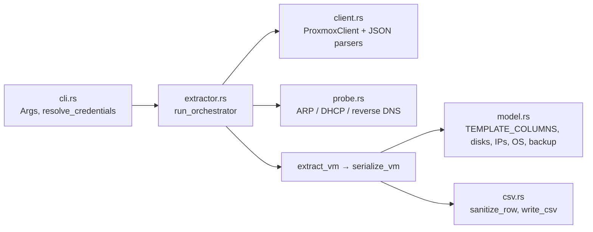

# Repository Guidelines

## Project Overview

`proxmox-inventory-extract` is a single-crate Rust CLI. It reads QEMU VM inventory from a Proxmox VE cluster over the REST API and writes a CSV that matches InventoryMGR's bulk-import schema (39 fixed columns). The project is Rust only; the earlier Python implementation was removed, so do not reintroduce Python scripts or tooling. `README.md` holds the user-facing details: flags, CSV column sources, disk format and exit codes. Keep it in sync when behavior changes.

## Architecture & Data Flow

The crate is a library with a thin binary. `src/main.rs` runs `Args::parse()`, calls `extractor::run_orchestrator`, then `std::process::exit(code)`.



`run_orchestrator` (`src/extractor.rs`) runs these steps in order:
1. Authenticate, then fetch the cluster name, online nodes, backup jobs and HA resources.
2. Load the probe tables.
3. List VMs with `cluster/resources?type=vm`, keeping only `qemu/` IDs, so LXC is excluded. If that call fails or returns nothing, list VMs node by node and set the partial flag.
4. Build per-node storage caches.
5. Spawn one `tokio::spawn` task per VM, bounded by a `Semaphore` of size `--workers`. Shared state goes through `Arc`, and each row keeps its index so row order is preserved.
6. Write the CSV with `write_csv`.

Each column value comes from the first source in its chain that produces a result:
- **IPs:** guest agent (running VMs only) → cloud-init `ipconfigN` → IPs in tags → MAC lookup in ARP/DHCP. The MAC lookup only runs when the VM's node is the local short hostname.
- **FQDN:** agent dotted hostname → DHCP lease hostname → reverse DNS over private, backup, then public IPs → `<name>.<searchdomain>` → blank.
- **OS family:** agent osinfo → `ostype` mapping → `linux`.

Exit codes: `0` ok, `1` fatal (auth, node enumeration or CSV write failed), `2` partial (a node or VM was skipped, or the VM-list fallback was used).

## Key Directories

- `src/` holds the library modules plus `main.rs`. There are no `#[cfg(test)]` modules in `src/`.
- `tests/` holds integration tests, one crate per file, named `<module>_test.rs`.
- There is no `scripts/`, `docs/`, CI or `.cargo/` directory.

## Development Commands

```bash
cargo build --release --locked          # binary: target/release/proxmox-inventory-extract (-j1 on low-memory nodes)
cargo test --locked                     # full suite; no network or env vars needed
cargo test --locked --test parity_test  # one test file
cargo test --locked --test model_test test_parse_size  # filter by name
cargo clippy --locked --all-targets -- -D warnings      # lint gate (README-documented)
cargo fmt --check                       # default rustfmt; no rustfmt.toml
```

Run the binary against a host:

```bash
PVE_API_TOKEN='root@pam!inv=<uuid>' ./target/release/proxmox-inventory-extract -H pve:8006 -o out.csv
```

## Code Conventions & Common Patterns

- **Errors:** functions return `Result<_, String>`. There is no `anyhow`, no `thiserror` and no custom error enum. The two exceptions are `ProxmoxClient::new`, which returns `reqwest::Error`, and `write_csv`, which returns `io::Error`. Do not add an error crate for a single call site.
- **Logging:** use `eprintln!` with the prefixes `[warn]`, `[error]` and `[ok]`. Only the final `[ok]` line goes to stdout. `api_get` already logs its own failures, so callers that log again produce duplicate messages.
- **Soft failures:** guest-agent and HA calls swallow errors and return empty or `None`. If a VM's config fetch fails, `extract_vm` returns a `None` row, which sets exit code 2. Keep that split: missing optional data never aborts the run.
- **Async:** tokio (`full`) and reqwest 0.12 with `rustls-tls` and `default-features = false`. Never re-enable the reqwest default features (that brings in native-tls/OpenSSL). Blocking work such as DNS goes through `spawn_blocking` plus `tokio::time::timeout`.
- **Auth headers are set by hand in `api_get`:**
  - Tokens are sent as `Authorization: PVEAPIToken=<user@realm!id=uuid>`.
  - Tickets are sent as the `PVEAuthCookie` cookie plus a CSRF header.
  - The reqwest `cookies` feature and clap's `env` feature are both unused. `resolve_credentials` reads `PVE_API_TOKEN` and `PVE_PASSWORD` with `std::env::var`, in this order: `--api-token`, then `PVE_API_TOKEN`, then `-p`, then `PVE_PASSWORD`, then a TTY prompt.
- **TLS:** cert checks are skipped unless `--verify-ssl` is passed (`danger_accept_invalid_certs(!verify_ssl)`), because Proxmox ships a self-signed cert. `ProxmoxClient::new` adds `https://` when the host has no scheme. Tests rely on this by passing `http://127.0.0.1:<port>`.
- **Pure parsers kept apart from I/O:** `client.rs` has parsers (`unwrap_response`, `unwrap_agent_result`, `parse_cluster_name`, `parse_ha_vmids`, `parse_guest_*`), and `model.rs` has more (`parse_size_to_gib`, `classify_ips`, `map_os_family`, `backup_coverage`, `DISK_KEY_RE`). Put new parsing logic in these pure functions so it can be unit-tested without HTTP.
- **Rows:** a row is a `HashMap<String, String>` keyed by column name. Every cell is a `String`, booleans are `"true"`/`"false"` and unused columns are `""`. The column order and the output contract are `model::TEMPLATE_COLUMNS`. Change it only to match InventoryMGR.
- **Validation:** `csv.rs` has the `ENUM`, `BOOL`, `INT`, `DATE` and `REQUIRED` column sets. `sanitize_row` blanks invalid cells and returns warnings; it never fails the row.
- **Naming:** snake_case free functions with `parse_*`, `build_*`, `get_*` and `map_*` prefixes. There are no traits or DI containers. The only test seam is the `--host` base URL.
- **Lints:** `#[allow(clippy::too_many_arguments)]` is used only on `serialize_vm` and `extract_vm`. Do not spread it further.
- **Known quirks:** do not "fix" these without checking the tests.
  - `parse_size_to_gib` rounds a non-zero sub-GiB size up to 1. Storage-content sizes round down (`extractor.rs` `build_volume_sizes`).
  - `classify_ips` maps `10.*` → `backup_ip`, `202.*` → `public_ip` and everything else → `private_ip`.
  - A `ProxmoxClient::new` failure is reported as "Authentication failed".

## Important Files

| Path | Role |
|---|---|
| `src/main.rs` | Entry point: `#[tokio::main]`, parse args, exit with the orchestrator's code |
| `src/cli.rs` | clap `Args` (defaults: host `127.0.0.1:8006`, user `root@pam`, timeout 30, workers 8, probe-timeout 2.0), `AuthMethod`, `resolve_credentials` |
| `src/client.rs` | `ProxmoxClient` (auth, `api_get`, endpoint wrappers) plus pure JSON parsers |
| `src/extractor.rs` | `run_orchestrator`, `extract_vm`, `serialize_vm`, storage caches, status mapping |
| `src/model.rs` | `TEMPLATE_COLUMNS`, `DiskRecord`, disk/size/IP/OS/tag parsing, `backup_coverage` |
| `src/csv.rs` | Column type sets, `sanitize_row`, RFC 4180 `write_csv` |
| `src/probe.rs` | `read_arp_table(path)`, `read_dhcp_leases(globs)`, `reverse_dns`. Paths are parameters. These return empty off-Linux. |
| `Cargo.toml` | Dependencies; no profiles, lints, features or MSRV field (README says Rust 1.80+) |
| `.gitignore` | Ignores `/target/`, `*.csv` and `*.log`. A committed CSV fixture must be force-added or renamed. |

## Runtime/Tooling Preferences

- Use Rust stable with Cargo only, and pass `--locked` (`Cargo.lock` is committed). Edition 2021.
- The target runtime is Linux on or near a Proxmox VE 7–9 host. Probing reads `/proc/net/arp` and dnsmasq lease globs, so on non-Linux hosts probe output is empty.
- On this Windows workstation, `cargo build` and `cargo test` fail at link time. MSVC Build Tools are not installed, so `link.exe` on PATH resolves to Git's `C:\Program Files\Git\usr\bin\link.exe`. Build and test on Linux (the target platform) or after installing VS Build Tools.
- Choose dependencies with a small footprint: rustls only, no OpenSSL. `src/csv.rs` shadows the `csv` crate name, so refer to the external crate as `::csv::` inside the crate.

## Testing & QA

- Tests use the built-in `#[test]` and `#[tokio::test]`. The only dev-dependency is `tempfile`, used for temp files and temp dirs.
- **Mock Proxmox API:** each HTTP test file starts its own `tokio::net::TcpListener` on `127.0.0.1:0`. It matches the request path and returns inline `json!` bodies, and it stops through a `oneshot` shutdown channel.
  - The mock is copy-pasted, not shared, in `client_test.rs`, `extractor_test.rs` (`spawn_mock_extractor_server*`) and `parity_test.rs` (`spawn_live_pve_mock_server`).
  - A new endpoint must be added to every mock that the code path reaches.
  - Authenticated routes check the token header, or the cookie plus the CSRF header.
- `parity_test.rs` runs two end-to-end `run_orchestrator` cases, one with ticket auth and one with API-token auth. The mock replays payloads captured from a live PVE 9.2.10 host, and the output must match that host's behavior exactly.
- Orchestrator tests build `Args` as a full struct literal (`no_probe: true`, `quiet: true`, `workers: 2`, `timeout: 5`). Adding a field to `Args` means updating every one of those literals.
- `csv_test.rs` and `parity_test.rs` are the contract tests:
  - all 39 columns are present, in order;
  - RFC 4180 quoting;
  - enum, boolean and integer validity.
- `probe_test.rs` writes Linux-format ARP and lease fixtures to temp files.
- Test functions are named `test_<snake_case>`. Table-driven tests end in `_cases`. Fixtures are inline; there are no fixture files.
- There is no coverage tooling or threshold. Before finishing, `cargo test --locked` and `cargo clippy --locked --all-targets -- -D warnings` must both pass.

## Agent skills

### Issue tracker

Issues live in GitHub Issues for `tejasach06/proxmox-inventory-extract`, managed with the `gh` CLI. See `docs/agents/issue-tracker.md`.

### Triage labels

Default vocabulary: `needs-triage`, `needs-info`, `ready-for-agent`, `ready-for-human`, `wontfix`. See `docs/agents/triage-labels.md`.

### Domain docs

Single-context: `GLOSSARY.md` and `docs/adr/` at the repo root, created lazily. See `docs/agents/domain.md`.
