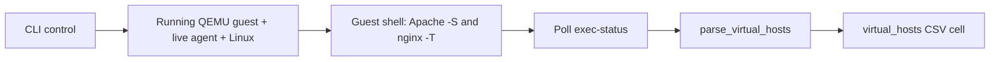

# Virtual host extraction through the Proxmox guest agent

Research date: 2026-11-15. Scope: research and an implementation plan. No application code changes or live guest access.

## Recommendation

Reuse the existing Apache and nginx discovery through QEMU guest-agent execution. Add `--no-virtual-hosts` to let operators skip it while preserving today's default. Describe the CSV value as **configured web virtual host names discovered inside the guest**. It does not establish that those names are currently served or reachable.

| Approach | What it establishes | Cost and tradeoff |
| --- | --- | --- |
| Existing guest-agent configuration inspection, with `--no-virtual-hosts` | Names parsed from the selected Apache and nginx configuration | Smallest change. Preserves default output. Requires guest command execution privileges. Recommended. |
| Opt-in `--virtual-hosts` | The same configuration evidence | Avoids guest execution by default, but changes current behavior and leaves the column empty in existing invocations. Use only if that default change is intended. |
| Add service or process checks | A matching daemon appears active alongside configuration evidence | More distribution-specific logic. Does not prove that the daemon loaded the inspected configuration. Defer. |
| Probe HTTP and HTTPS with Host headers and SNI | A selected endpoint responds from the probe's network location | Separate reachability feature with port, TLS, routing, wildcard and timeout decisions. Defer. |

## Feasibility and limits

Proxmox supports executing commands through the guest agent. Its documentation requires an installed guest agent, enabled communication in VM Options, and a fresh VM start after changing that option. The agent must also be running and permit the requested commands. This needs no SSH account or guest network access. See [Proxmox guest-agent documentation](https://github.com/proxmox/pve-docs/blob/master/qm.adoc) and [the generated `qm guest exec` reference](https://github.com/proxmox/pve-docs/blob/master/generated/qm.1-synopsis.adoc).

QEMU `guest-exec` returns a process identifier. `guest-exec-status` reports completion and captured output. Output can be truncated, and checking an exited process also reaps its associated metadata. A caller's polling deadline does not itself terminate the guest process. See [QEMU guest-agent protocol](https://www.qemu.org/docs/master/interop/qemu-ga-ref.html#command-guest-exec).

Apache `-S` reports virtual host settings parsed from configuration. Prefer its distribution wrapper where available. Apache also supports alternative configuration files and server roots, so a default invocation can inspect a different configuration from a custom service. See [Apache `httpd` options](https://httpd.apache.org/docs/2.4/programs/httpd.html) and [the documented `apachectl -S` example](https://httpd.apache.org/docs/2.4/vhosts/).

nginx `-T` tests and dumps configuration. Its `-c` and `-p` options can select a different configuration file and prefix. The existing script uses defaults. See [nginx command-line parameters](https://nginx.org/en/docs/switches.html).

These commands can succeed while the web server is stopped. A running daemon can also retain older configuration after a failed reload. Therefore neither configuration dumps nor a service-active check prove that a discovered hostname is currently served. nginx explicitly documents retaining its old configuration if a reload fails. See [nginx configuration reload behavior](https://nginx.org/en/docs/control.html#reconfiguration).

nginx server names include exact names, wildcards, regular expressions and special values. A list of extracted tokens is not a complete list of concrete websites. See [nginx server names](https://nginx.org/en/docs/http/server_names.html).

### Permissions

This operation executes a shell inside the guest and needs more authority than ordinary inventory reads. Modern Proxmox documentation defines `VM.GuestAgent.Unrestricted` as unrestricted guest-agent access, including commands. That supports the privilege requirement generally, but this investigation did not verify the exact `exec` and `exec-status` permission checks for every supported PVE release. See [Proxmox privilege definitions](https://github.com/proxmox/pve-docs/blob/master/pveum.adoc).

The README currently associates PVE 9 with `VM.GuestAgent.Unrestricted` and older releases with `Sys.Modify` or `VM.Monitor`. The precise historical endpoint requirements remain unverified. Before publishing a version-by-version permission recipe, check both endpoints in the official API viewer or matching `qemu-server` release source. Do not grant broader permissions based solely on this note. Agent command allowlists or blocklists can still prevent execution even when the API identity has permission.

## Existing implementation

`run_orchestrator` in `src/extractor.rs` lists QEMU VMs and spawns bounded tasks. Each task calls `extract_vm`, which fetches VM configuration and optional guest data. Virtual host discovery runs only for a running VM with a live guest agent whose resolved OS family is Linux. OS-family fallback can classify unknown guests as Linux, so unsupported shells must continue to fail softly.

`ProxmoxClient::get_guest_virtual_hosts` in `src/client.rs` posts `/bin/sh -c <VHOST_SCRIPT>` to `/nodes/{node}/qemu/{vmid}/agent/exec`. It polls `/agent/exec-status?pid=...` up to 25 times with 200 ms sleeps between unsuccessful checks. That is about five seconds of sleeps **plus HTTP request time**, not a strict five-second deadline.

`VHOST_SCRIPT` runs the first installed command among `apachectl`, `apache2ctl` and `httpd` with `-S`. It then runs `nginx -T` if nginx is installed and filters `server_name` lines. It does not check whether either web server is running. `parse_virtual_hosts` returns sorted, deduplicated, lowercase names and removes selected placeholders and IP literals. `serialize_vm` joins names with semicolons in the existing `virtual_hosts` column.

Failures produce an empty value. The existing 39-column CSV schema and optional-data exit-code policy already support that outcome.

## Implementation plan

1. Add `no_virtual_hosts: bool` with the long flag `--no-virtual-hosts` in `src/cli.rs`. Default it to false. Keep it independent of `--no-probe`, which controls local ARP and DHCP discovery.
2. In `run_orchestrator`, derive `virtual_hosts_enabled = !args.no_virtual_hosts` and pass that copyable boolean to each `extract_vm` call. `extract_vm` currently has 14 parameters and already allows `clippy::too_many_arguments`. One explicit boolean is the smallest wiring change. Keep the existing annotation and avoid a configuration-object refactor for this flag.
3. Guard only `get_guest_virtual_hosts` with the new boolean. Retain the existing running, live-agent and Linux conditions. Preserve guest-agent OS and IP collection and configuration-derived disks when virtual host discovery is disabled.
4. Update every full `Args` literal in `tests/extractor_test.rs` and `tests/parity_test.rs`, plus every direct `extract_vm` caller in `tests/extractor_test.rs`. Set existing cases to enabled behavior so their expectations remain intact.
5. In `tests/cli_test.rs`, cover the default and flag parsing. In `tests/extractor_test.rs`, run the disabled-discovery case through `run_orchestrator` with `Args.no_virtual_hosts` true. After completion, assert request counters show neither `agent/exec` nor `exec-status` was called. Assert an empty virtual-host cell, preserved guest IPs, OS and configuration-derived disks, all 39 columns, row order and exit code 0. A direct `extract_vm` test alone cannot prove flag-to-worker wiring. Keep the existing enabled and unavailable-agent cases. Preserve both authentication paths in `tests/parity_test.rs` and existing parser cases in `tests/client_test.rs`.
6. Update the `README.md` options table and both virtual-host descriptions with the flag, default, prerequisites and precise configured-name semantics. Replace the `get_guest_virtual_hosts` doc comment's claim of names “served” by the guest with “configured” names. Keep CSV columns and serialization unchanged.
7. On Linux, run `cargo test --locked`, `cargo clippy --locked --all-targets -- -D warnings`, and `cargo fmt --check`. The current Windows workstation lacks the required MSVC linker. A later authorized live acceptance check should cover Apache, nginx, both installed, no web server, stopped VM, absent agent and denied exec privileges.

## Deferred findings and verification limits

The existing nginx filter reads one line at a time and misses multiline `server_name` directives. The generic token filter does not fully model quoted names or regular expressions. The script stops at the first installed Apache command even if that invocation fails. The client does not inspect guest exit status or truncation indicators. These are existing extraction limits, not requirements for the CLI control. Address them separately if complete configuration discovery is required.

Do not add containers, IIS, Caddy, SSH, DNS-based guesses, daemon restarts or service reloads to this change. No credentials, package changes, live execution, build, tests or performance measurements were used for this research. The implementation plan requires actual Linux validation before completion can be claimed.
